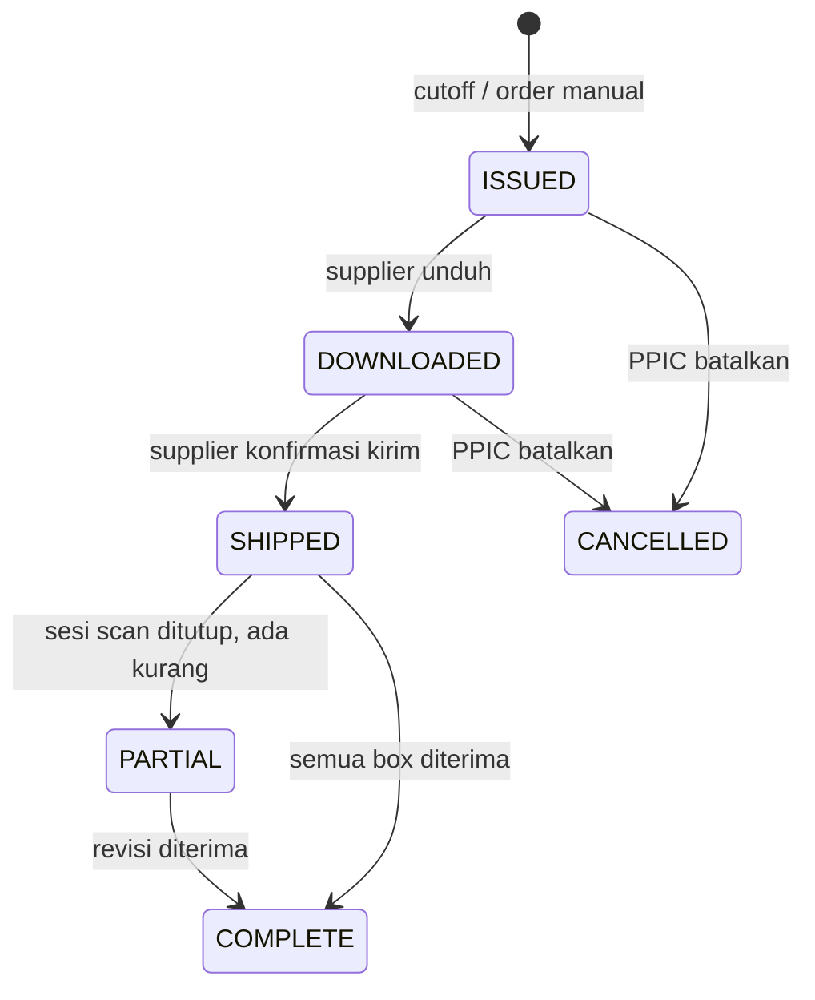
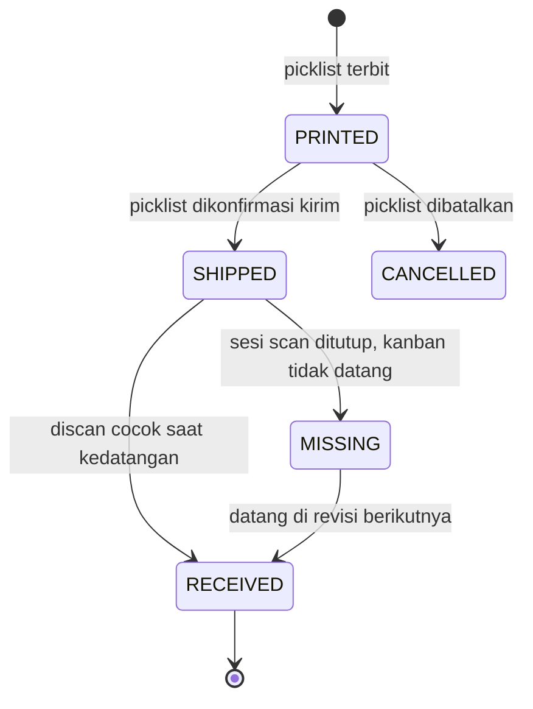
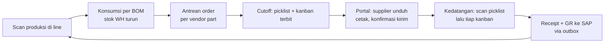
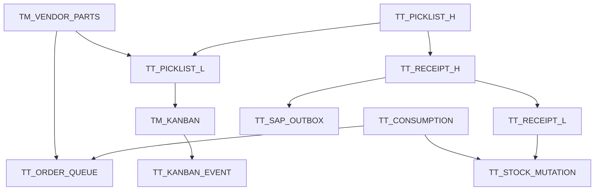
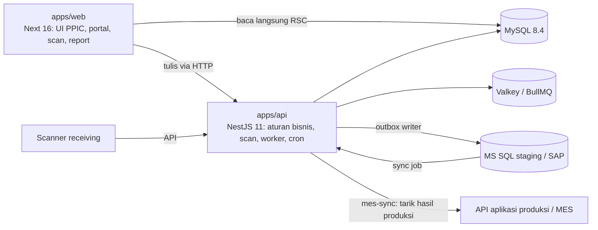

# ARES — PRD e-Kanban Supplier

Versi 2026-09-18 · sumber: dokumen PRD ARES (Claude Docs). File ini salinan untuk agen; perubahan dibuat di dokumen aslinya lalu diekspor ulang.

## 1. Ringkasan

ARES adalah sistem e-kanban supplier: setiap komponen yang dikonsumsi di line produksi otomatis menjadi order ke supplier pada jam cutoff, supplier mencetak picklist dan kanban lewat portal, dan kedatangan barang diverifikasi dengan scan sebelum diposting sebagai Good Receipt ke SAP. ARES menggantikan sistem e-kanban buatan vendor Jepang yang dipakai saat ini.

**Masalah yang diselesaikan**

- Order ke supplier masih bergantung pada perhitungan dan input manual; jumlah order tidak mengikuti konsumsi aktual.
- Supplier menerima order lewat jalur yang tidak tercatat; tidak ada bukti kapan order diambil dan dikonfirmasi.
- Kecocokan barang datang dengan order diperiksa manual, selisih baru ketahuan saat stock opname.
- Sistem lama tertutup, tidak bisa disesuaikan, dan tidak siap untuk SAP baru.

**Sasaran**

| Sasaran | Ukuran |
| --- | --- |
| Order otomatis dari konsumsi | 100% order reguler terbit dari antrean konsumsi tanpa input PPIC |
| Supplier mandiri | Picklist + kanban diunduh supplier sendiri; waktu unduh tercatat |
| Verifikasi kedatangan | Setiap box discan; selisih (kurang/lebih) tampil saat itu juga |
| Posting SAP andal | Tidak ada GR hilang; GR gagal tampil di layar error dan bisa dikirim ulang |
| Layar scan cepat | Respons scan < 300 ms |

**Bukan cakupan (v1)**

- Pembuatan PO: PO tetap dibuat di SAP.
- Stok keuangan: SAP tetap system of record; stok WH di ARES bersifat operasional.
- Subcont, claim, delivery ke customer, laporan bea cukai: dipertimbangkan setelah v1.
- Kartu kanban bolak-balik (returnable): kanban ARES sekali pakai.

## 2. Pengguna dan hak akses

Lima peran, hak akses per aksi (bukan per halaman) dan disimpan di database, bukan di kode. Satu user boleh punya lebih dari satu peran; akun supplier terikat ke satu kode vendor.

| Peran | Siapa | Bertanggung jawab atas | Output |
| --- | --- | --- | --- |
| PPIC | Staf PPIC | Setting cutoff & kebijakan, koreksi antrean, order manual, memantau konfirmasi supplier, error posting SAP | Picklist terbit, setting, keputusan short shipment |
| Warehouse (Receiving) | Operator gudang | Scan picklist & kanban saat kedatangan, menutup sesi scan, RDS partial | Receipt, kanban `RECEIVED`, GR ke SAP |
| Produksi | Operator line / sistem MES | Scan hasil produksi di line (memicu konsumsi per BOM) | Event konsumsi, stok WH turun |
| Supplier | Akun per vendor | Melihat order, mengunduh picklist & kanban, konfirmasi pengiriman | Kanban tercetak, status `SHIPPED`, ETA |
| Admin | IT / MIS | User, peran, master, integrasi | Akun, mapping vendor, konfigurasi |

**Aksi yang dibatasi khusus**

| Aksi | Boleh |
| --- | --- |
| Menerbitkan order manual | PPIC |
| Mengubah antrean sebelum cutoff (tambah, kurangi, hold) | PPIC |
| Membatalkan picklist yang sudah diunduh supplier | PPIC, tercatat di audit |
| Menutup sesi scan dengan selisih | Warehouse; alasan wajib diisi |
| Kirim ulang GR yang gagal | PPIC, Admin |
| Melihat data vendor lain | Tidak ada peran supplier yang boleh; dibatasi di query, bukan hanya di menu |

Akun internal memakai SSO perusahaan bila tersedia; akun supplier memakai username/password lokal dengan kadaluarsa password dan pembatasan percobaan login.

## 3. Konsep inti

ARES bekerja sebagai loop konsumsi: apa yang dipakai line produksi, itulah yang diorder ulang ke supplier pada cutoff berikutnya.

| Istilah | Arti di ARES |
| --- | --- |
| Vendor part | Pasangan part × supplier beserta qty per box, back number, rak tujuan, tipe box |
| Konsumsi | Pengurangan stok WH per komponen, dihitung dari scan hasil produksi × BOM (bukan per box) |
| Antrean order | Akumulasi konsumsi (pcs) per vendor part sejak cutoff terakhir, ditambah carry-over |
| Cutoff | Jam tutup antrean per supplier; saat cutoff antrean berubah jadi picklist |
| Picklist | Dokumen order ke supplier untuk satu cutoff: header (supplier, tanggal kirim, cycle) + line (part, jumlah box) |
| Kanban | Label sekali pakai per box, dibuat saat picklist terbit, dicetak supplier, discan saat kedatangan |
| Revisi | Versi baru picklist untuk sisa yang belum diterima (short shipment / partial receipt) |

**Siklus hidup picklist**



Picklist `ISSUED` yang belum diunduh sampai batas waktu tampil sebagai peringatan di dashboard PPIC; `DOWNLOADED` yang belum `SHIPPED` sampai jam kirim tampil sebagai terlambat.

**Siklus hidup kanban (sekali pakai)**



Kanban berakhir di `RECEIVED`; ia tidak dipakai untuk scan keluar. Konsumsi dicatat lewat BOM (bagian 5.2), jadi kanban hanya alat verifikasi kedatangan dan jejak asal box.

**Konsumsi per BOM**

Scan satu hasil produksi part A di line memicu satu event konsumsi per komponen di BOM A: `qty_konsumsi = qty_produksi × qty_per`. Stok WH komponen turun sebesar itu dan antrean order vendor part komponen bertambah sebesar itu. Rak, jumlah box, dan kanban tidak terlibat di langkah ini.

## 4. Alur utama

Satu putaran penuh: konsumsi di line hari ini menjadi picklist saat cutoff, barang datang di cycle berikutnya, dan GR terposting ke SAP setelah scan.



| # | Langkah | Aktor | Sistem melakukan | Output |
| --- | --- | --- | --- | --- |
| 1 | Scan hasil produksi part jadi | MES (ditarik ARES via API) | Explode BOM, catat konsumsi tiap komponen, kurangi stok WH | Event konsumsi |
| 2 | Akumulasi antrean | ARES (otomatis) | Tambah pcs konsumsi ke antrean vendor part; PPIC bisa lihat & koreksi | Antrean per supplier |
| 3 | Cutoff | ARES (job terjadwal) | Konversi pcs ke box (aturan 6.1), ambil PO item dari cache, terbitkan picklist + kanban per box, kirim email | Picklist `ISSUED`, kanban `PRINTED` |
| 3b | Order manual | PPIC | Pilih supplier, part, jumlah box; sama seperti langkah 3 tanpa antrean | Picklist `ISSUED` |
| 4 | Unduh & cetak | Supplier | Catat waktu unduh pertama; PDF picklist (barcode header) + PDF kanban (QR per box) | Picklist `DOWNLOADED` |
| 5 | Konfirmasi kirim | Supplier | Isi jumlah box dikirim per line, ETA, no. kendaraan; kurang dari order = short shipment (aturan 6.3) | Picklist & kanban `SHIPPED` |
| 6 | Kedatangan: buka sesi | Warehouse | Scan barcode picklist; layar menampilkan line: part, box diorder, box discan | Sesi scan aktif |
| 7 | Scan kanban | Warehouse | Validasi tiap kanban (aturan 6.4); hijau cocok, kuning sudah, merah salah | Kanban `RECEIVED` |
| 8 | Tutup sesi | Warehouse | Ringkasan cocok/kurang/lebih; kurang jadi revisi (aturan 6.5); buat receipt | Receipt, picklist `COMPLETE`/`PARTIAL` |
| 9 | Posting GR | ARES (worker) | Satu baris outbox per receipt; kirim ke SAP; simpan nomor dokumen SAP atau error | GR terposting / error log |
| 10 | Stok WH naik | ARES | Tambah stok WH sebesar pcs diterima | Stok WH |

Langkah 1 berasal dari aplikasi produksi (MES): ARES menarik hasil produksi lewat API aplikasi itu (bagian 8.2), lalu menghitung konsumsi per BOM. Layar scan produksi di ARES hanya cadangan.

## 5. Kebutuhan fungsional

Prioritas: **M** = wajib di v1, **S** = sebaiknya v1, **L** = setelah v1.

### 5.1 Master & setting (PPIC, Admin)

| ID | Kebutuhan | Prio |
| --- | --- | --- |
| F-01 | Master supplier & part disinkron dari SAP (read-only); sebelum sinkron tersedia, CRUD manual dengan kolom nomor SAP wajib | M |
| F-02 | Vendor part: part, supplier, qty per box, back number, rak, tipe box, aktif/nonaktif, PO item default | M |
| F-03 | BOM per part jadi: komponen, qty per, berlaku dari/sampai; sinkron dari SAP atau upload Excel | M |
| F-04 | Setting cutoff per supplier: daftar jam cutoff per hari (boleh lebih dari satu), hari kerja, lead time ke tanggal kirim, jam kedatangan per cutoff | M |
| F-05 | Kalender hari libur dan aturan geser: cutoff jatuh di libur → maju ke hari kerja sebelumnya atau mundur ke sesudahnya (pilihan per supplier) | M |
| F-06 | Setting kebijakan short shipment per supplier: `carry_over` (sisa masuk cutoff berikutnya) atau `revision` (revisi picklist yang sama) | M |
| F-07 | Setting pembulatan box: `floor + carry-over` (default) atau `ceil` | S |
| F-08 | Setting batas waktu peringatan: belum unduh setelah N jam, belum konfirmasi H jam sebelum jam kirim | S |
| F-09 | Riwayat perubahan setting (siapa, kapan, nilai lama/baru) | M |

### 5.2 Konsumsi & antrean order

| ID | Kebutuhan | Prio |
| --- | --- | --- |
| F-10 | Job tarik hasil produksi dari API aplikasi produksi (MES) per interval, cursor sejak record terakhir, explode BOM → event konsumsi per komponen | M |
| F-11 | Kunci idempoten per record MES; layar scan produksi ARES hanya sebagai cadangan bila API MES tidak tersedia | M |
| F-12 | Antrean per vendor part: pcs terakumulasi, ekuivalen box, sisa carry-over, waktu cutoff berikutnya | M |
| F-13 | PPIC bisa menambah/mengurangi pcs, atau hold satu vendor part dari cutoff berikutnya; wajib alasan; tercatat | M |
| F-14 | Konsumsi setelah jam cutoff otomatis masuk cutoff berikutnya | M |
| F-15 | Pembatalan/koreksi scan produksi (salah scan) membalik konsumsi selama antrean belum dicutoff | S |

### 5.3 Order

| ID | Kebutuhan | Prio |
| --- | --- | --- |
| F-16 | Job cutoff per supplier sesuai F-04: konversi antrean ke box, cek PO item, terbitkan picklist | M |
| F-17 | Order manual: pilih supplier, tanggal kirim, cutoff/cycle, part & jumlah box; boleh digabung ke picklist cutoff berikutnya atau terbit sendiri | M |
| F-18 | Vendor part tanpa PO item aktif: tidak diterbitkan, tampil sebagai *blocked* di dashboard PPIC dengan alasan | M |
| F-19 | Validasi open qty PO: outstanding picklist per PO item ≤ open qty; melebihi → blocked | S |
| F-20 | Pembatalan picklist oleh PPIC sebelum `SHIPPED`; pcs dikembalikan ke antrean bila berasal dari konsumsi | M |

### 5.4 Picklist & kanban

| ID | Kebutuhan | Prio |
| --- | --- | --- |
| F-21 | Penomoran picklist unik, berurutan per hari, aman dari dua proses bersamaan | M |
| F-22 | Satu kanban per box dengan ID unik (ULID) dan serial per picklist; QR berisi ID kanban saja | M |
| F-23 | PDF picklist: header supplier, tanggal & jam kedatangan, cycle, PO, barcode picklist, tabel part/back no/box/pcs | M |
| F-24 | PDF kanban: kartu ukuran tetap berisi part, nama, back number besar, qty/box, supplier, rak, cycle, serial, QR, nomor picklist | M |
| F-25 | Revisi picklist: nomor sama + suffix revisi, hanya memuat line yang belum diterima; kanban lama yang `MISSING` tetap berlaku | M |
| F-26 | Cetak ulang PDF oleh PPIC dan supplier; setiap unduhan tercatat | M |
| F-27 | PDF dibuat di worker dan disimpan; permintaan cetak ulang tidak menghitung ulang | S |

### 5.5 Portal supplier

| ID | Kebutuhan | Prio |
| --- | --- | --- |
| F-28 | Dashboard: order baru (belum unduh), order berjalan, terlambat konfirmasi, riwayat | M |
| F-29 | Unduh picklist dan kanban; unduhan pertama menandai `DOWNLOADED` dengan waktu | M |
| F-30 | Konfirmasi kirim per picklist: jumlah box dikirim per line, ETA, no. kendaraan, catatan | M |
| F-31 | Email otomatis saat picklist terbit dan saat direvisi; ke semua akun vendor itu | M |
| F-32 | Riwayat penerimaan: box dikirim vs diterima per picklist, selisih | S |
| F-33 | Ganti password, lupa password via email | M |

### 5.6 Receiving scan

| ID | Kebutuhan | Prio |
| --- | --- | --- |
| F-34 | Sesi scan dibuka dengan barcode picklist; satu sesi per picklist per perangkat | M |
| F-35 | Layar menampilkan line picklist dengan counter box diorder / dikirim / discan, diperbarui tiap scan | M |
| F-36 | Validasi kanban (aturan 6.4) dengan umpan balik warna + bunyi dalam < 300 ms | M |
| F-37 | Tutup sesi: ringkasan cocok/kurang/lebih; kurang wajib alasan; hasil sesuai kebijakan short shipment | M |
| F-38 | Scan dobel tidak menggandakan data (kunci idempoten per kanban per sesi) | M |
| F-39 | Sesi yang terputus (perangkat mati) bisa dilanjutkan dari kanban terakhir | S |
| F-40 | Pembatalan receipt oleh PPIC sebelum GR terkirim; setelah terkirim, buat GR pembalik | S |

### 5.7 Stok WH

| ID | Kebutuhan | Prio |
| --- | --- | --- |
| F-41 | Stok WH per part = Σ receipt − Σ konsumsi ± penyesuaian; tampil pcs dan ekuivalen box | M |
| F-42 | Penyesuaian manual oleh PPIC dengan alasan; tercatat | S |
| F-43 | Laporan selisih stok WH ARES vs stok SAP per sloc (data SAP dari sinkron) | S |

### 5.8 Integrasi SAP

| ID | Kebutuhan | Prio |
| --- | --- | --- |
| F-44 | Sinkron PO open items per supplier ke cache ARES; jadwal + tombol manual | M |
| F-45 | Outbox GR: satu baris per receipt, status `PENDING/SENT/FAILED/HELD`, percobaan, error, nomor dokumen SAP | M |
| F-46 | Layar error posting: daftar `FAILED`, detail pesan, kirim ulang, tahan | M |
| F-47 | Kunci idempoten lintas sistem (nomor receipt) agar kirim ulang tidak dobel | M |
| F-48 | Sinkron master vendor, part, BOM dari SAP | S |

### 5.9 Laporan & dashboard

| ID | Kebutuhan | Prio |
| --- | --- | --- |
| F-49 | Dashboard PPIC: picklist hari ini per status, supplier belum unduh/konfirmasi, order blocked, GR gagal | M |
| F-50 | Laporan kedatangan: per supplier per periode, tepat/terlambat, box kurang/lebih | M |
| F-51 | Laporan konsumsi & order: pcs konsumsi vs box diorder per part per periode | S |
| F-52 | Ekspor Excel di semua laporan | S |

### 5.10 Administrasi

| ID | Kebutuhan | Prio |
| --- | --- | --- |
| F-53 | User, peran, permission per aksi; akun supplier terikat vendor | M |
| F-54 | Audit log semua perubahan dokumen dan setting: siapa, kapan, sebelum/sesudah | M |
| F-55 | Log integrasi (payload kirim/terima) tersimpan 90 hari | S |

## 6. Aturan bisnis

Aturan ini adalah acuan tunggal untuk fungsi murni di `packages/domain`; setiap aturan punya unit test.

**6.1 Konversi antrean ke box (saat cutoff)**

1. `total_pcs = antrean_pcs + carry_over_pcs`.
2. Default `floor`: `box = floor(total_pcs / qty_per_box)`, `carry_over_baru = total_pcs mod qty_per_box`. Opsi `ceil` (F-07): `box = ceil(total_pcs / qty_per_box)`, carry-over 0.
3. `box = 0` → vendor part tidak masuk picklist; carry-over tetap tersimpan.
4. Vendor part dengan status hold (F-13) dilewati; antreannya tidak dihapus.
5. Semua vendor part satu supplier pada satu cutoff masuk satu picklist.

**6.2 Cutoff dan kalender**

1. Jam cutoff dievaluasi pada zona waktu pabrik (Asia/Jakarta), disimpan UTC.
2. Tanggal kirim = tanggal cutoff + lead time supplier (hari kerja), jam kedatangan dari setting cutoff itu.
3. Cutoff atau tanggal kirim yang jatuh di hari libur digeser sesuai pilihan supplier (F-05); antrean tidak hilang, hanya ikut cutoff hasil geser.
4. Cutoff tidak boleh dijalankan dua kali untuk pasangan supplier × jam × tanggal; kunci di database, bukan di scheduler.
5. Konsumsi yang tercatat tepat pada detik cutoff masuk cutoff berikutnya.

**6.3 Short shipment (konfirmasi supplier)**

1. Supplier mengonfirmasi `box_dikirim` per line, boleh kurang dari `box_diorder`, tidak boleh lebih.
2. Kebijakan `carry_over`: selisih × qty\_per\_box dikembalikan ke antrean vendor part; line ditandai `SHORT`; kanban selisih menjadi `CANCELLED`.
3. Kebijakan `revision`: selisih menjadi line di revisi picklist yang sama dengan tanggal kirim berikutnya; kanban selisih tetap `PRINTED` dan berlaku di revisi itu.
4. Setelah `SHIPPED`, jumlah kirim tidak bisa diubah supplier; perubahan lewat PPIC dan tercatat.

**6.4 Validasi scan kanban**

| Kondisi | Hasil | Umpan balik |
| --- | --- | --- |
| Kanban milik picklist sesi ini, status `SHIPPED`, belum discan | `RECEIVED`, counter naik | Hijau + bunyi pendek |
| Kanban sama discan lagi di sesi ini | Tidak ada perubahan | Kuning: "Sudah diterima HH:MM" |
| Kanban milik picklist lain | Ditolak | Merah: "Kanban picklist \<nomor>" |
| Kanban `CANCELLED` atau `RECEIVED` di sesi lain | Ditolak | Merah: alasan |
| Kode bukan kanban ARES | Ditolak | Merah: "Kode tidak dikenal" |
| Kanban `MISSING` dari revisi sebelumnya, picklist sesi ini adalah revisinya | `RECEIVED` | Hijau |

Kanban `PRINTED` (supplier belum konfirmasi kirim) tetap boleh diterima; sistem mencatat konfirmasi otomatis dengan penanda *tanpa konfirmasi supplier* untuk laporan.

**6.5 Penutupan sesi scan**

1. Semua kanban `SHIPPED` discan → picklist `COMPLETE`.
2. Ada kanban `SHIPPED` yang tidak discan → kanban itu `MISSING`, picklist `PARTIAL`, alasan wajib; tindak lanjut mengikuti kebijakan F-06 (revisi picklist atau kembali ke antrean).
3. Receipt dibuat per sesi ditutup, berisi pcs diterima per line; satu baris outbox GR per receipt.
4. Stok WH bertambah saat receipt dibuat, bukan saat GR terkonfirmasi SAP; GR gagal tidak mengubah stok WH tetapi tampil di error log sampai selesai.

**6.6 Picklist dan PO**

1. Setiap line picklist menyimpan nomor PO dan item SAP yang berlaku pada tanggal kirim; tanpa itu line tidak terbit (F-18).
2. Nomor picklist tidak pernah dipakai ulang, termasuk setelah pembatalan.
3. Picklist yang sudah `SHIPPED` tidak bisa dibatalkan; penyelesaiannya lewat sesi scan.
4. Revisi mewarisi nomor PO; bila PO sudah habis/berakhir, revisi blocked sampai PPIC memilih PO lain.

**6.7 Konsumsi**

1. Konsumsi dihitung dari BOM yang berlaku pada waktu scan produksi.
2. Satu label produksi hanya bisa dikonsumsi sekali (kunci idempoten = ID label); scan ulang tidak menggandakan.
3. Koreksi konsumsi (F-15) hanya untuk konsumsi yang belum masuk picklist; setelah itu koreksi lewat penyesuaian stok dan order manual.

## 7. Model data

16 tabel inti; nama tabel `TM_` (master) / `TT_` (transaksi) dengan kolom huruf besar mengikuti konvensi MIS, properti TypeScript camelCase lewat Drizzle. Semua tabel punya `ID`, `CREATED_AT`, `UPDATED_AT`; status memakai enum, bukan flag teks.



| Tabel | Isi | Kolom kunci |
| --- | --- | --- |
| TM\_VENDOR | Supplier (salinan SAP) | SAP\_VENDOR\_NO, NAME, ADDRESS, EMAIL, ACTIVE |
| TM\_PARTS | Part (salinan SAP) | SAP\_MATERIAL\_NO, PART\_NO, NAME, UOM |
| TM\_VENDOR\_PARTS | Part per supplier | PART\_ID, VENDOR\_ID, QTY\_PER\_BOX, BACK\_NO, RACK, BOX\_TYPE, PO\_ITEM\_DEFAULT, ACTIVE; unik (PART\_ID, VENDOR\_ID) |
| TM\_BOM | Komponen per part jadi | PARENT\_PART\_ID, COMPONENT\_PART\_ID, QTY\_PER, EFFECTIVE\_FROM/TO |
| TM\_VENDOR\_CUTOFF | Jadwal cutoff | VENDOR\_ID, CUTOFF\_TIME, LEAD\_DAYS, ARRIVAL\_TIME, HOLIDAY\_SHIFT, SHORT\_SHIP\_POLICY, ROUNDING |
| TM\_HOLIDAY | Kalender libur | DATE, NAME |
| TT\_CONSUMPTION | Event konsumsi | SOURCE\_KEY (idempoten), PARENT\_PART\_ID, COMPONENT\_PART\_ID, QTY, LINE, OCCURRED\_AT, QUEUE\_ID |
| TT\_ORDER\_QUEUE | Antrean per vendor part per cutoff | VENDOR\_PART\_ID, CUTOFF\_AT, PCS, CARRY\_OVER\_PCS, HOLD, STATUS(OPEN/CLOSED) |
| TT\_QUEUE\_ADJUSTMENT | Koreksi PPIC | QUEUE\_ID, DELTA\_PCS, REASON, USER\_ID |
| TT\_PICKLIST\_H | Header order | NO, REVISION, TYPE(AUTO/MANUAL), VENDOR\_ID, CUTOFF\_AT, DELIVERY\_DATE, ARRIVAL\_TIME, STATUS, DOWNLOADED\_AT, SHIPPED\_AT, ETA, VEHICLE\_NO; unik (NO, REVISION) |
| TT\_PICKLIST\_L | Line order | PICKLIST\_ID, VENDOR\_PART\_ID, BOX\_ORDERED, BOX\_SHIPPED, BOX\_RECEIVED, PCS, SAP\_PO\_NO, SAP\_PO\_ITEM, STATUS |
| TM\_KANBAN | Satu box | ID (ULID, isi QR), PICKLIST\_LINE\_ID, SERIAL, STATUS, RECEIVED\_AT |
| TT\_KANBAN\_EVENT | Jejak kanban | KANBAN\_ID, TYPE, USER\_ID, DEVICE\_ID, AT, REF |
| TT\_RECEIPT\_H / TT\_RECEIPT\_L | Penerimaan per sesi scan | RECEIPT\_NO, PICKLIST\_ID, CLOSED\_AT, USER\_ID, NOTE; line: PICKLIST\_LINE\_ID, PCS\_RECEIVED, BOX\_RECEIVED |
| TT\_SCAN\_EVENT | Setiap scan | DEDUPE\_KEY unik, SESSION\_ID, CODE, RESULT, AT |
| TT\_STOCK\_MUTATION | Buku stok WH | PART\_ID, SLOC, DELTA\_PCS, TYPE(RECEIPT/CONSUMPTION/ADJUST), REF\_TABLE, REF\_ID |
| TT\_SAP\_OUTBOX | Antrean ke SAP | SOURCE\_TABLE, SOURCE\_ID, DOC\_TYPE, IDEMPOTENCY\_KEY unik, PAYLOAD, STATUS, ATTEMPTS, LAST\_ERROR, SAP\_DOC\_NO |
| TT\_PO\_HEADER / TT\_PO\_LINE | Cache PO SAP | SAP\_PO\_NO, VENDOR\_ID, VALID\_FROM/TO; line: ITEM, PART\_ID, OPEN\_QTY, SYNCED\_AT |
| TM\_SEQUENCE | Penomoran | CODE, DATE\_KEY, LAST\_NO; dibaca dengan `SELECT … FOR UPDATE` |
| TM\_USER / TM\_ROLE / TM\_PERMISSION / TM\_USER\_ROLE | Akses | USER: VENDOR\_ID nullable (akun supplier) |
| TT\_AUDIT\_LOG | Jejak perubahan | ENTITY, ENTITY\_ID, ACTION, USER\_ID, BEFORE, AFTER, AT |

Stok WH per part adalah `SUM(DELTA_PCS)` dari `TT_STOCK_MUTATION`, disajikan lewat view atau tabel saldo yang diperbarui per mutasi; tidak ada kolom stok yang diedit langsung.

## 8. Antarmuka & integrasi

ARES tidak pernah memanggil SAP dari dalam request; semua ke luar lewat outbox, semua dari luar lewat job sinkron. Empat kontrak SAP di bawah adalah pilihan ideal yang masih harus dikonfirmasi tim SAP (bagian 13).

**8.1 Kontrak SAP**

| Arah | Data | Mekanisme yang diusulkan | Frekuensi |
| --- | --- | --- | --- |
| SAP → ARES | PO open items per supplier (PO/SA, item, part, open qty, berlaku) | Tabel staging MS SQL atau OData `API_PURCHASEORDER_PROCESS_SRV` | Tiap jam + manual |
| SAP → ARES | Master vendor, material, BOM | Tabel staging / OData | Harian |
| ARES → SAP | Good Receipt 101 ke PO item, delivery note = nomor picklist, reference = nomor receipt | Outbox → tabel staging MS SQL (pola `TT_GOODS_MOVEMENT_H/L`) atau `API_MATERIAL_DOCUMENT_SRV` | Per receipt, worker |
| ARES → SAP | Pembatalan GR (102) | Sama, doc type berbeda | Per pembatalan |

Asumsi: SAP menjalankan backflush konsumsi dari konfirmasi produksi (bukan dari ARES); ARES hanya mengirim penerimaan. Bila ternyata SAP mengharapkan goods issue dari ARES, itu menjadi doc type outbox tambahan tanpa mengubah alur.

Payload outbox GR (JSON, contoh):

```json
{
  "docType": "GR",
  "idempotencyKey": "RCP-260918-0007",
  "plant": "J901",
  "sloc": "WH00",
  "deliveryNote": "PL-260917-0042",
  "postingDate": "2026-09-18",
  "items": [
    { "poNo": "4500123456", "poItem": "00010", "material": "90311-12345", "qty": 200, "uom": "PC" }
  ]
}
```

**8.2 Hasil produksi dari aplikasi produksi (MES)**

ARES **menarik** hasil produksi dari API aplikasi produksi, lalu menghitung konsumsi per BOM sendiri. Aplikasi produksi tidak perlu tahu BOM maupun ARES.

| Hal | Ketentuan |
| --- | --- |
| Pemicu | Job `mes-sync` di worker tiap 1–5 menit (dapat diatur) + tombol tarik manual di layar PPIC |
| Permintaan | `GET <MES>/production-results?since=<cursor>&limit=500`; cursor = ID/waktu record terakhir yang sudah diproses, disimpan ARES |
| Data minimal per record | ID record unik, part jadi, qty, line, waktu produksi |
| Idempotensi | `sourceKey = MES:<ID record>`; record yang sudah ada dilewati |
| Kegagalan | API MES tidak tersedia → job mengulang dengan backoff; antrean tidak berubah; tunggakan dan waktu tarik terakhir tampil di dashboard |
| Koreksi | Record yang dibatalkan di MES (bila API menyediakannya) membalik konsumsi selama belum dicutoff (F-15) |

Contoh respons yang diharapkan dari MES:

```json
{
  "items": [
    { "id": "PR-20260918-000123", "partNo": "A-1000", "qty": 1, "line": "L3", "producedAt": "2026-09-18T08:41:12+07:00" }
  ],
  "nextCursor": "PR-20260918-000123"
}
```

Bila aplikasi produksi lebih mudah mendorong data, endpoint `POST /api/consumption` dengan isi record yang sama tetap disediakan sebagai alternatif; keduanya bermuara ke `TT_CONSUMPTION` yang sama.

**8.3 Spesifikasi kode**

| Kode | Simbologi | Isi | Alasan |
| --- | --- | --- | --- |
| Kanban | QR, error correction M | `ARES:K:<ULID>` (contoh `ARES:K:01J8Z3M5X8Q9W2Y7V6T5R4S3P2`) | Pendek, unik global, tahan perubahan atribut; detail diambil dari DB |
| Picklist | Code128 | `ARES:P:<NO>-<REV>` | Membuka sesi scan; revisi ikut terbaca |
| Label produksi (jika dari ARES) | QR | `ARES:L:<ULID>` | Kunci idempoten konsumsi |

Prefix `ARES:` memungkinkan scanner menolak kode asing tanpa query.

**8.4 Email**

| Peristiwa | Penerima | Isi |
| --- | --- | --- |
| Picklist terbit / direvisi | Semua akun vendor | Nomor, tanggal & jam kirim, jumlah line & box, tautan portal |
| Belum diunduh setelah N jam (F-08) | Akun vendor, cc PPIC | Pengingat |
| GR gagal 3× | PPIC, Admin | Nomor receipt, pesan SAP |

**8.5 Realtime (opsional v1)**

SSE dari API untuk layar monitor receiving (picklist yang sedang discan, progres) dan dashboard PPIC; tidak dipakai untuk logika.

## 9. Kebutuhan non-fungsional

| Aspek | Kebutuhan |
| --- | --- |
| Kinerja scan | Respons validasi kanban < 300 ms (p95) di jaringan pabrik; halaman scan tanpa aset berat, satu input selalu fokus |
| Kinerja halaman | Daftar & laporan dirender di server; halaman utama PPIC < 2 detik dengan 10.000 picklist/bulan |
| Ketersediaan | Jam operasi gudang 24/6; deploy tanpa downtime untuk web; worker boleh restart (job idempoten) |
| Ketahanan integrasi | SAP/MS SQL mati tidak menghentikan scan; outbox menampung, retry dengan backoff, tunggakan tampil di dashboard |
| Keamanan | HTTPS; JWT berumur pendek untuk user, token perangkat terpisah untuk scanner/MES; permission per aksi di server; query supplier di-scope vendor di lapisan data |
| Audit | Semua perubahan dokumen, setting, dan scan tercatat dengan user, perangkat, waktu; log tidak bisa diedit |
| Idempotensi | Scan, konsumsi, cutoff, dan posting SAP masing-masing punya kunci unik di database |
| Zona waktu | Simpan UTC, tampil dan evaluasi cutoff di Asia/Jakarta |
| Perangkat | Scanner keyboard-wedge (USB/BT) di PC/tablet, browser Chromium; kamera HP tidak diwajibkan di v1 |
| Data | Retensi transaksi minimal 5 tahun; log integrasi 90 hari; backup harian DB |
| Kapasitas awal | 100 supplier, 3.000 vendor part, 2.000 kanban/hari, 20 stasiun scan bersamaan |
| Bahasa | Antarmuka Bahasa Indonesia; portal supplier Indonesia + Inggris |

## 10. Antarmuka pengguna

Tampilan ARES **identik** dengan Avicenna MES: sistem desain, kerangka halaman, komponen, dan aturan animasinya disalin apa adanya dari `apps/web` Avicenna; yang berubah hanya wordmark, menu, dan isi halaman. Tidak ada komponen UI baru selain yang memang belum ada di Avicenna.

**10.1 Yang disalin utuh dari Avicenna**

| Bagian | Sumber di Avicenna | Catatan untuk ARES |
| --- | --- | --- |
| Token warna, radius, bayangan, mode gelap, 5 aksen (hitam, biru, hijau, jingga, ungu) | `src/app/globals.css` (`@theme`, `data-theme`, `data-accent`) | Sama persis; latar hangat netral `#e6e0d8`, kartu putih `radius-card 1.5rem`, panel `2rem` |
| Font | Plus Jakarta Sans 400–800 via `next/font` | Sama |
| Skrip anti-kilat tema | `NO_FLASH` di `app/layout.tsx` | Sama, kunci localStorage diganti `ares.preferences` |
| Kerangka aplikasi | `components/shell/*`: `ShellFrame`, `Sidebar` (264 px / mode ikon 76 px), `Topbar` 76 px, `SettingsPanel`, `Breadcrumb` | Wordmark `ARES`, subjudul `e-Kanban Supplier`; item menu di 10.2 |
| Preferensi pengguna | `lib/preferences.ts`: tema, aksen, mode sidebar, bunyi scan | Sama |
| Primitif UI | `components/ui/*`: `Button` (solid/outline/ghost, pil), `Card` + `CardHeader` + `CardBody`, `Chip`, `StatusBadge`, `StatCard` + `CountUp`, `Table`/`Th`/`Td`/`Tr`/`EmptyState`, `IconBadge`, `IconButton`, `InfoRow`, `PageHeader` | Sama |
| Animasi | `a-rise`, `a-fade`, `a-stagger` (CSS); Motion hanya untuk pil navigasi, umpan balik sentuh, dropdown, baris realtime; `prefers-reduced-motion` dihormati | Sama; aturan "kemunculan pakai CSS, bukan JS" wajib |
| Stasiun scan | `components/scan/scan-station.tsx`, `station-bar.tsx`, `use-scan-sound.ts` (beep 880 Hz ok, 300+240 Hz tolak) | Dipakai untuk sesi receiving; kolom kanan berisi line picklist |
| Halaman login | `app/login/page.tsx`: panel `max-w-[420px]`, `rounded-panel`, `a-stagger` | Sama; label `NPK` untuk internal, `Kode vendor / email` untuk supplier |
| Ikon | lucide-react, `strokeWidth` 1.8–2.2, ikon dalam lingkaran bergaris tipis | Sama |

**10.2 Kerangka dan navigasi**

Tiga route group seperti Avicenna, ditambah satu untuk supplier:

| Route group | Kerangka | Pengguna |
| --- | --- | --- |
| `(app)` | Sidebar + topbar + area gulir (`ShellFrame`) | PPIC, Admin, Warehouse (halaman daftar & laporan) |
| `(station)` | Tanpa sidebar, `bg-surface`, satu tugas per layar | Warehouse (sesi scan receiving), Produksi (scan cadangan) |
| `(portal)` | `ShellFrame` yang sama, sidebar berisi menu supplier saja, wordmark `ARES · <nama vendor>` | Supplier |
| `login` | Panel tengah, tanpa kerangka | Semua |

Menu sidebar `(app)` (`nav-config.ts`):

| Grup | Item | Ikon lucide |
| --- | --- | --- |
| Operasi | Dashboard, Antrean order, Picklist, Sesi scan | `LayoutDashboard`, `ListOrdered`, `ClipboardList`, `ScanLine` |
| Logistik | Penerimaan, Stok WH, Konsumsi | `Truck`, `Boxes`, `Factory` |
| Integrasi | SAP outbox, Sinkron MES | `Share2`, `RefreshCw` |
| Laporan | Kedatangan, Konsumsi & order | `BarChart3`, `FileSpreadsheet` |
| Setting | Cutoff supplier, Kebijakan, Kalender libur | `Clock`, `SlidersHorizontal`, `CalendarDays` |
| Master data (dapat dilipat) | Supplier, Part, Vendor part, BOM, User & peran | dari `ENTITY_DEFS` |

Menu `(portal)`: Order baru, Order berjalan, Riwayat, Akun.

**10.3 Komposisi halaman (pola tetap)**

1. `PageHeader`: breadcrumb, judul 28 px extrabold, deskripsi berisi angka ("12 picklist hari ini"), tombol aksi utama pil hitam di kanan.
2. Baris `StatCard` (3–4 kartu) untuk halaman dashboard dan daftar.
3. `Card` + `CardHeader` (ikon lingkaran + judul) berisi `Table`; kolom angka `tabular` rata kanan; `EmptyState` dengan kalimat ajakan; baris terbungkus `Reveal`/`a-stagger`.
4. Detail dokumen: `InfoRow` untuk header, `Chip`/`StatusBadge` untuk status (`ok` hijau, `warn` kuning, `ng` merah, `live` indigo, `muted`).
5. Form: input `h-12 rounded-2xl bg-surface`, label 14 px semibold, error `text-ng` dengan ikon `AlertCircle`.
6. Halaman transaksional `export const dynamic = 'force-dynamic'`; data dibaca di Server Component.

**10.4 Layar stasiun (receiving)**

Mengikuti tata letak `ScanStation`: kolom kiri input scan (autofocus permanen, klik di mana pun mengembalikan fokus), kolom tengah hasil besar (hijau `ACCEPTED`, kuning `DUPLICATE`, merah tolak) dengan pesan satu baris, kolom kanan daftar. Untuk ARES kolom kanan diganti tabel line picklist: part, back number, box diorder / dikirim / discan, dan progres. `StationBar` di atas menampilkan nomor picklist, supplier, jam kedatangan, tombol *Tutup sesi*. Bunyi mengikuti preferensi pengguna.

**10.5 Aturan yang tidak boleh dilanggar**

- Kontras teks tinggi dan ukuran dasar 14–15 px tidak dikecilkan; layar dilihat dari jarak jauh dan monitor tua.
- Tidak ada warna di luar token; semantik hanya `ok`, `warn`, `ng`, `live`.
- Kemunculan elemen memakai animasi CSS `backwards`, bukan Motion `initial={{opacity:0}}`, supaya halaman tetap tampil bila hidrasi gagal.
- Satu aksi utama per halaman memakai tombol solid; sisanya `outline`/`ghost`.
- Bahasa antarmuka Indonesia, gaya kalimat sama dengan Avicenna (kalimat pendek, tanpa jargon Inggris bila ada padanannya).

## 11. Arsitektur & stack

Mengikuti pola monorepo Avicenna MES: tiga proses, satu database, aturan **pekerjaan > 200 ms masuk antrean**.



| Lapisan | Pilihan | Catatan |
| --- | --- | --- |
| Monorepo | pnpm + Turborepo, TypeScript | `apps/web`, `apps/api`, `packages/db`, `packages/domain`, `packages/contracts` |
| Web | Next 16 App Router, React 19, Tailwind 4 | Route group `(app)` PPIC/WH, `(station)` scan, `(portal)` supplier; halaman transaksional `force-dynamic` |
| API | NestJS 11, zod pipe, JWT | Modul: master, consumption, queue, picklist, portal, receiving, sap, notify, realtime |
| Data | Drizzle + MySQL 8.4 | Skema bagian 7; penomoran dengan `FOR UPDATE` dalam transaksi |
| Antrean | BullMQ + Valkey | Job: `cutoff` (repeatable per supplier), mes-sync (tarik hasil produksi), `sap-outbox`, `sap-sync`, `pdf-render`, `mail` |
| Domain | fungsi murni + Vitest | Aturan bagian 6: konversi box, kalender cutoff, validasi scan, state machine |
| PDF & kode | `@react-pdf/renderer`, `bwip-js` | Dirender di worker, disimpan; diunduh lewat API |
| Deploy | Docker on-prem: web, api, worker, MySQL, Valkey | Tanpa cloud; SAP di jaringan internal |

Pembagian baca/tulis: halaman membaca database langsung lewat Server Component; semua perubahan data lewat API. Perangkat (scanner, MES) hanya bicara ke API.

## 12. Tahapan rilis

Irisan vertikal tipis dulu, dipakai supplier pilot, baru dilebarkan. Estimasi untuk 2–3 developer, di luar waktu tunggu akses SAP.

| Fase | Cakupan | Kriteria selesai | Perkiraan |
| --- | --- | --- | --- |
| 0. Discovery | Konfirmasi kontrak SAP (bagian 13), daftar supplier & vendor part pilot, layout kartu kanban disetujui gudang | Dokumen kontrak SAP ditandatangani tim SAP; 2 supplier pilot setuju | 3 minggu |
| 1. MVP | Master & setting (F-01–F-06), order manual (F-17), picklist & kanban PDF (F-21–F-24), portal unduh & konfirmasi (F-28–F-31), sesi scan & receipt (F-34–F-38), outbox GR ke SAP QA (F-45–F-47), audit (F-54) | 2 supplier pilot menjalankan 20 picklist end-to-end; GR muncul di SAP QA; selisih scan terdeteksi | 8–10 minggu |
| 2. Loop otomatis | Scan produksi & API konsumsi (F-10–F-11), antrean & koreksi (F-12–F-14), job cutoff (F-16), short shipment (6.3), revisi (F-25), stok WH (F-41), dashboard PPIC (F-49) | Order reguler supplier pilot 100% dari cutoff selama 2 minggu tanpa input manual | 6–8 minggu |
| 3. Produksi penuh | Semua supplier, PO validation (F-19), pembatalan & GR balik (F-40), laporan (F-50–F-52), pengingat (F-08), sinkron master (F-48) | Sistem Jepang dimatikan; parallel run selesai | 6 minggu |
| 4. Lanjutan | Subcont/PSN, claim, delivery ke customer, kamera HP untuk scan | Ditentukan setelah fase 3 | — |

**Migrasi & cutover**

1. Hanya master yang dimigrasi (supplier, vendor part, BOM, cutoff); transaksi lama diarsipkan read-only.
2. Nomor picklist mulai seri baru.
3. Parallel run per kelompok supplier 2 minggu: order dari sistem lama tetap jalan, penerimaan discan di ARES; stok WH ARES dibandingkan SAP tiap hari.
4. Cutover per kelompok supplier, bukan serentak.

## 13. Asumsi, risiko, pertanyaan terbuka

**Asumsi**

1. PO (atau scheduling agreement) dibuat dan dikelola di SAP; ARES hanya mereferensikannya.
2. SAP adalah system of record stok; stok WH di ARES operasional dan direkonsiliasi, bukan sumber laporan keuangan.
3. Backflush konsumsi ke SAP dilakukan dari konfirmasi produksi (MES/SAP), bukan oleh ARES.
4. Supplier mencetak kanban sendiri; tidak ada pencetakan terpusat di pabrik untuk v1.
5. Kanban sekali pakai; tidak ada kartu bolak-balik.
6. Aplikasi produksi (MES) menyediakan API hasil produksi per part jadi dengan ID record unik, dan ARES diberi akses untuk menariknya.

**Risiko**

| Risiko | Dampak | Mitigasi |
| --- | --- | --- |
| Akses SAP QA/kontrak staging terlambat | Fase 1 tidak bisa selesai | Mulai dengan `FakeSapGateway`; kontrak dikunci di fase 0 |
| Scan produksi tidak disiplin (lupa/dobel) | Order kurang atau lebih | Kunci idempoten, laporan konsumsi vs hasil produksi harian, koreksi antrean PPIC |
| BOM di SAP tidak akurat | Konsumsi salah komponen | Sinkron BOM harian, laporan komponen tanpa konsumsi > N hari |
| Supplier tidak membuka portal | Picklist tidak dicetak, barang datang tanpa kanban | Email + pengingat, jalur cetak oleh PPIC sebagai cadangan |
| Dua sistem memposting GR ke gudang sama (jika ada MES dengan receiving) | Dobel GR | Tetapkan ARES sebagai satu-satunya pemilik GR supplier |
| Konfigurasi cutoff salah (jam, libur) | Order tidak terbit | Simulasi cutoff (dry-run) di layar setting, peringatan jika supplier tanpa cutoff aktif |

**Pertanyaan terbuka**

- [ ] Bentuk komitmen di SAP: PO blanket bulanan atau scheduling agreement? (menentukan 8.1 dan F-19)
- [ ] Mekanisme integrasi: tabel staging MS SQL, OData langsung, atau middleware (CPI)?
- [ ] Plant dan storage location yang dipakai untuk GR (`J901`/`WH00` di contoh hanya placeholder).
- [ ] Apakah SAP membutuhkan goods issue dari ARES, atau backflush cukup dari konfirmasi produksi?
- [ ] Aplikasi produksi mana yang menyediakan API hasil produksi, dan kontraknya: endpoint, autentikasi, cursor/paginasi, ID record, seberapa sering boleh ditarik?
- [ ] Apakah API MES memberi tahu record yang dibatalkan/dikoreksi, agar konsumsi bisa dibalik (F-15)?
- [ ] Kebijakan default short shipment untuk semua supplier saat go-live: `carry_over` atau `revision`?
- [ ] Ukuran fisik kartu kanban dan printer yang dipakai supplier (menentukan layout F-24).

## 14. Glosarium

| Istilah | Arti |
| --- | --- |
| ARES | Nama sistem e-kanban supplier ini |
| Back number | Kode lokasi/identitas part yang dicetak besar di kanban untuk dibaca operator |
| BOM | Bill of material: daftar komponen dan qty per unit part jadi |
| Carry-over | Sisa pcs konsumsi yang belum genap satu box, dibawa ke cutoff berikutnya |
| Cutoff | Waktu tutup antrean konsumsi untuk satu supplier; memicu penerbitan picklist |
| Cycle | Kedatangan ke-n dalam satu hari untuk satu supplier |
| GR | Good Receipt: posting penerimaan barang ke SAP terhadap PO item |
| Kanban | Label sekali pakai per box, berisi QR ID kanban |
| MES | Manufacturing execution system di line produksi |
| Outbox | Tabel antrean dokumen keluar ke SAP dengan status dan kunci idempoten |
| Picklist | Dokumen order ke supplier untuk satu cutoff; header + line |
| PO item | Baris purchase order di SAP yang dirujuk line picklist |
| Receipt | Hasil satu sesi scan kedatangan; dasar posting GR |
| Revisi | Versi baru picklist yang hanya memuat line/kanban yang belum diterima |
| Short shipment | Supplier mengirim lebih sedikit dari yang diorder |
| Vendor part | Pasangan part × supplier beserta atribut kanban |
| WH | Gudang komponen tempat barang supplier diterima dan disimpan |
